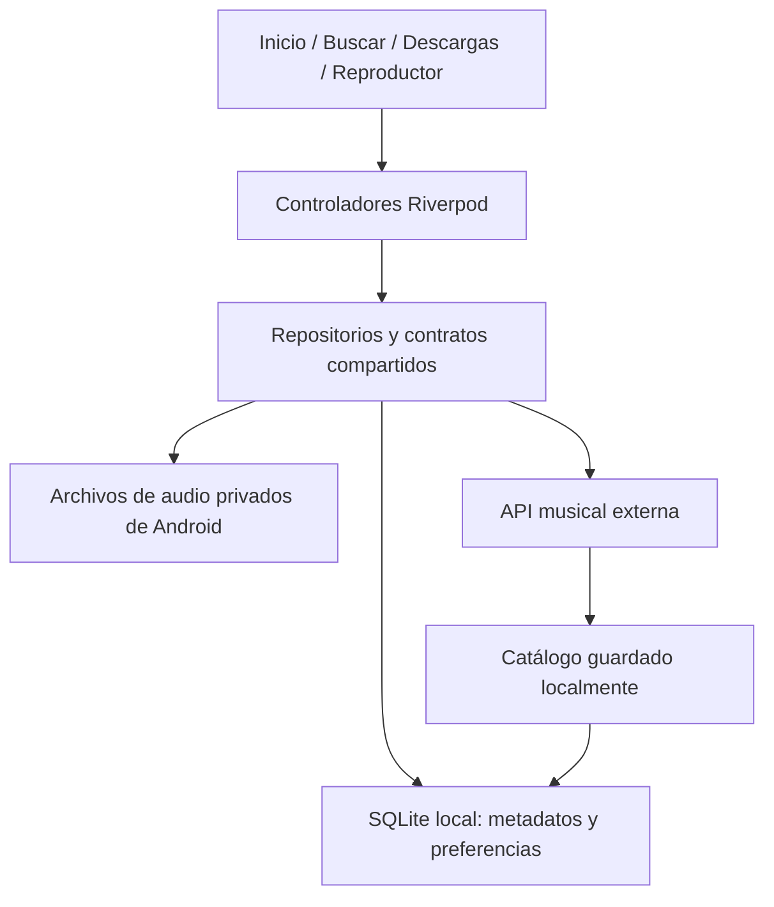

# SoundWave — Plan de implementación del MVP

Fecha de elaboración: 15 de octubre de 2026.

Este documento es una propuesta de implementación y coordinación. Las tareas,
ramas y contratos descritos todavía deben implementarse; escribir este plan no
crea issues, instala dependencias ni modifica la aplicación.

## 1. Objetivo y alcance acordado

Entregar una aplicación Android que permita buscar música mediante una API,
descargar canciones permitidas, reproducirlas sin conexión y omitir o bloquear
canciones no deseadas. Los datos deben conservarse después de cerrar y volver
a abrir la aplicación.

Decisiones confirmadas por el equipo:

- **Android:** plataforma de aceptación del MVP completo.
- **Chrome:** herramienta para revisar interfaz y navegación con datos de
  demostración; no es plataforma de aceptación de descargas ni SQLite.
- **API musical externa:** fuente del catálogo y del acceso al audio.
- **SQLite local:** persistencia en cada dispositivo Android.
- **Riverpod:** manejo de estado e inyección de dependencias, conforme al
  [ADR-0001](adr/0001-manejo-de-estado.md).
- **Diseño existente:** mantener la identidad oscura y turquesa; esta etapa
  conecta funcionalidades, no requiere otro rediseño.

No se plantea construir un backend propio en esta primera entrega. La capa de
datos y servicios estará dentro de Flutter y consumirá la API elegida. Si esa
API exige un secreto que no pueda distribuirse en una aplicación móvil, el
equipo tendrá que evaluar un intermediario y ajustar el alcance antes de
integrarla. Un secreto no queda protegido por colocarlo en un archivo `.env`
incluido en la aplicación.

### 1.1 Flujo de aceptación

1. Abrir Inicio y consultar el catálogo disponible.
2. Buscar una canción por título o artista.
3. Descargarla y observar su progreso o un error recuperable.
4. Ver la canción disponible en Inicio y Mis descargas.
5. Abrir esa misma canción en el reproductor.
6. Reproducir, pausar, cambiar de posición y omitir una pista.
7. Bloquear una canción para que no vuelva a sonar en la colección definida.
8. Cerrar completamente la aplicación, activar modo avión y volver a abrirla.
9. Reproducir las canciones descargadas y comprobar los bloqueos guardados.

### 1.2 Fuera del alcance inicial

- Cuentas de usuario y sincronización entre dispositivos.
- Recomendaciones personalizadas y algoritmos de descubrimiento.
- Descargas automáticas por lotes o selección de calidad.
- Reproducción en segundo plano con controles del sistema, salvo que la rúbrica
  del curso la exija; en ese caso se estimará como una tarea adicional.
- Reproducción de música desde servicios que no permitan obtener y almacenar
  el archivo mediante su API.
- Implementación completa de almacenamiento offline en Chrome.
- Publicación de un servidor propio o de una plataforma musical comercial.

## 2. Estado del proyecto revisado

La revisión de código y GitHub se realizó sobre `main`, commit
`85f9aef060cc4c1f4d6ff75e160f01fa967df699`. Estos hallazgos describen ese punto
del historial, no garantizan que futuras versiones mantengan el mismo estado.

| Área | Implementado | Trabajo pendiente |
| --- | --- | --- |
| Inicio | Diseño, secciones y navegación inferior | Consultar datos comunes y dar función a las tarjetas |
| Búsqueda | Filtrado de canciones mock por título y artista | Consumir API y catálogo local; ofrecer descarga |
| Descargas | Lista de seis mocks, eliminación, Deshacer y estado en memoria | Archivos reales y persistencia SQLite |
| Reproductor | Controles y bloqueo simulado | Audio real; sustituir el temporizador por eventos del motor |
| Modelos | Cada módulo tiene modelos locales | Modelo compartido e identificadores estables |
| Persistencia | Estado de sesión en descargas | Esquema, migraciones y repositorios SQLite |
| Pruebas | Suite general y pruebas del módulo de descargas | Flujo integrado Android, API, archivos y reinicios |

### 2.1 Corrección de integración prioritaria

`main.dart` abre `DownloadsScreen`, definida en
`features/downloads/downloads_screen.dart`, que es un placeholder. La interfaz
completa existente se llama `DownloadScreen`, en `download_screen.dart`.

Douglas deberá conectar la pestaña con `DownloadScreen` en un PR pequeño. Carmen
revisará que se conserve su diseño y funcionamiento. No deben mantenerse dos
implementaciones activas de la misma pantalla. La eliminación o retirada del
placeholder se acordará explícitamente en ese PR.

### 2.2 Calidad y pruebas existentes

En la revisión previa a este documento pasaron:

- 10 pruebas al ejecutar la suite habitual con `flutter test --no-pub`.
- 8 pruebas al ejecutar explícitamente
  `flutter test --no-pub lib/features/downloads/test/download_screen_test.dart`.

El CI actual ejecuta `flutter test`, que no descubre automáticamente las pruebas
guardadas dentro de `lib/features/downloads/test/`. Carmen trasladará sus pruebas
a `test/features/downloads/` en su PR, conservando su contenido y cobertura.
Henry comprobará que el CI las ejecute.

Los resultados anteriores no sustituyen la validación de cada PR futuro. En el
entorno Windows se observó previamente un `FormatException` interno del servidor
LSP al ejecutar `flutter analyze`; `dart analyze` fue una alternativa útil. El
CI debe mantener el análisis habitual y no desactivar controles para ocultar
problemas del entorno.

## 3. Equipo y trazabilidad

La asignación siguiente se basa en los aportes revisados y propone la propiedad
técnica para esta etapa; no pretende reemplazar automáticamente los roles del
README ni las asignaciones de GitHub.

| Responsable | Evidencia revisada | Frente propuesto |
| --- | --- | --- |
| Henry Baquiax — `BaquiaxAntonio` | Estructura, Riverpod, ADR y CI | Arquitectura, contratos y SQLite |
| Douglas Jacobo — `douglas-yasser` | Inicio y navegación, PR #23 | Inicio, navegación e integración |
| Carmen — `Ortizcarmen` | Descargas, estado y pruebas, PR #22 | Descargas reales y archivos locales |
| `ramosdeleon555` | Reproductor y bloqueo, PR #16; aportes de búsqueda/UX en el historial | Audio real y preferencias de reproducción |
| `JavEstrada09` | Propuesta de búsqueda, PR #21 cerrado sin merge | Evaluación de API e integración de búsqueda |

El README también menciona a Jeffersson Daniel Ramos y Rolando de Leon. Los
perfiles públicos consultados no exponen nombres completos que permitan
confirmar ambas correspondencias con las cuentas. Hasta que el equipo lo
aclare, se usarán los usuarios GitHub para asignar tareas sin inventar nombres.

### 3.1 Corregir la numeración de tareas

La numeración usada en conversaciones previas no coincide completamente con el
tablero: el Issue #6 actual corresponde al buscador y el #5 a Home. No asumir
que esos números representan persistencia y lista de descargas respectivamente.

Antes de iniciar esta fase, revisar los issues abiertos, actualizar sus criterios
y crear nuevas tareas MVP donde corresponda. Los identificadores `MVP-01`, etc.,
usados aquí son etiquetas de planificación, no números reales de GitHub.

## 4. Arquitectura propuesta



### 4.1 Principios

1. Una canción tiene el mismo ID en API, SQLite, descargas y reproductor.
2. Los widgets no ejecutan SQL ni escriben archivos directamente.
3. Los repositorios exponen operaciones; los controladores coordinan la UI.
4. SQLite es la fuente persistente del estado local. Los cambios en memoria
   deben reflejar las operaciones confirmadas o revertirse si fallan.
5. La reproducción offline no depende de consultar la API ni de renovar una URL.
6. Un único proveedor administra la conexión y el ciclo de vida de la base.
7. El motor de audio tiene un ciclo de vida definido fuera de la pantalla para
   que cambiar de pestaña no cree reproductores duplicados.
8. Las diferencias Android/Chrome se resuelven mediante implementaciones
   intercambiables; no con accesos a `dart:io` desde widgets compartidos.

### 4.2 Dependencias candidatas

| Necesidad | Propuesta | Responsable de confirmar e incorporar |
| --- | --- | --- |
| SQLite Android | `sqflite` y manejo de rutas | Henry |
| Directorio privado de la app | `path_provider` | Henry, con requisitos de Carmen |
| Solicitudes HTTP y descarga por flujo | Un solo cliente, por ejemplo `http`; evaluar cancelación requerida | Henry y `JavEstrada09`, con Carmen |
| Audio local | `just_audio` | Henry, con requisitos de `ramosdeleon555` |
| Estado | Riverpod ya instalado | Todo el equipo |

No fijar versiones por copia de ejemplos. Henry verificará compatibilidad con el
SDK del proyecto y añadirá las dependencias acordadas en un único PR, incluyendo
`pubspec.lock`. Para audio en primer plano no se añadirá automáticamente una
solución de servicios en segundo plano.

## 5. Primera decisión: seleccionar y probar la API

Responsable: `JavEstrada09`. Revisión: Henry y Carmen.

La API debe superar una prueba técnica antes de reemplazar los mocks. No basta
con que devuelva títulos o portadas.

### 5.1 Criterios de selección

- Catálogo con identificadores estables, título y artista.
- Búsqueda o una estrategia viable de catálogo pequeño descargable.
- Audio accesible mediante un mecanismo documentado.
- Condiciones que permitan su descarga y reproducción offline en el proyecto.
- Límites de solicitudes compatibles con una demostración académica.
- Credenciales y cuotas manejables sin publicar secretos.
- Formatos reproducibles por el motor de audio elegido.
- Duración o posibilidad de obtenerla desde el archivo de audio.
- Identificación de URLs temporales, redirecciones y restricciones de acceso.

Una API que solo entrega previews puede servir para una demostración de
fragmentos si el equipo lo acepta expresamente; no se presentará como descarga
de canciones completas.

### 5.2 Entregables de la evaluación

1. Documento con API elegida, términos relevantes y límites.
2. Respuestas JSON de ejemplo sin tokens ni datos sensibles.
3. Prueba Android que busque, obtenga y reproduzca un audio permitido.
4. Confirmación de que el archivo puede conservarse y reproducirse sin red.
5. Catálogo pequeño y legal para pruebas reproducibles.
6. Estrategia ante errores de autenticación, cuota, red y enlaces vencidos.

Si la API no cumple, cambiar de proveedor antes de integrar las pantallas. Si
requiere backend intermediario, abrir una decisión de arquitectura y reestimar;
no introducirlo de forma improvisada dentro de una tarea de búsqueda.

## 6. Contratos compartidos antes de dividir el trabajo

Henry prepara el PR de contratos; todos lo revisan. Cada contrato debe incluir
firmas concretas, errores esperados, unidades, reglas y ejemplos. La tabla
siguiente define la intención inicial, no firmas Dart definitivas.

| Contrato | Responsabilidad | Implementación principal |
| --- | --- | --- |
| `Song` | Metadatos canónicos e identidad | Henry define; todos consumen |
| `DownloadRecord` | Estado persistente de una descarga | Henry define con Carmen |
| `CatalogRepository` | Buscar, consultar caché y actualizar catálogo | `JavEstrada09` |
| `DownloadRepository` | Observar, descargar, reintentar y eliminar | Carmen |
| `AudioFileStore` | Guardar, validar, localizar y retirar audio | Carmen |
| `PlaybackController` | Selección, cola y comandos de reproducción | `ramosdeleon555` |
| `PlaybackPreferencesRepository` | Bloqueos por colección | `ramosdeleon555` |
| Acceso SQLite y DAO | Operaciones locales y transacciones | Henry |

### 6.1 Modelo de canción

Campos mínimos: ID estable, título, artista, duración en milisegundos cuando se
conozca, proveedor e ID de origen. La representación de una URL de audio debe
permitir resolverla de nuevo si vence; no se tratará una URL temporal como ID.

La ruta de una descarga pertenece a `DownloadRecord`, no reemplaza la identidad
del catálogo. Los adaptadores transforman los modelos de la API en `Song`.

### 6.2 Estados de descarga

Estados propuestos: `queued`, `downloading`, `completed`, `failed` y
`pendingDeletion`. La cancelación se definirá explícitamente si se incorpora.

Cada registro tendrá `songId`, bytes recibidos, total conocido o nulo,
referencia local, fecha y error opcional. Cuando no se conozca el total se
mostrará progreso indeterminado, sin inventar porcentajes.

El actual `DownloadStatus` es un registro local de la fase mock. Henry y Carmen
acordarán su adaptación para evitar dos tipos distintos con el mismo nombre.

### 6.3 Dobles de prueba

El PR base incluirá implementaciones falsas mínimas y un conjunto de canciones
con IDs estables. Sirven para que todos trabajen simultáneamente aunque la API,
SQLite o el motor todavía no estén disponibles. En Android de entrega se
inyectarán las implementaciones reales; en Chrome se podrán inyectar demos.

## 7. SQLite y almacenamiento

### 7.1 Esquema local inicial

| Tabla | Campos principales y restricciones |
| --- | --- |
| `songs` | `id` PK, proveedor, ID de origen, título, artista, duración; identidad de origen única |
| `downloads` | `song_id` PK/FK, estado, referencia local, bytes, fecha y error |
| `playlists` | `id` PK y nombre; puede empezar con una colección offline predeterminada |
| `playlist_songs` | `playlist_id` y `song_id` como clave compuesta, posición |
| `blocked_songs` | Clave compuesta por colección y canción, fecha de bloqueo |

Definir claves foráneas, comportamiento al borrar, transacciones e índices para
las consultas reales. Henry será el único autor de migraciones y versiones de
esquema. Los demás propondrán cambios mediante revisión de contrato.

SQLite guarda metadatos. Los audios se guardan como archivos en almacenamiento
privado de Android. Preferir referencias relativas al directorio de la app para
no fijar rutas absolutas dependientes del dispositivo.

### 7.2 Reglas de consistencia de descargas

1. Descargar a un archivo temporal, por ejemplo con sufijo `.part`.
2. Validar la respuesta y comprobar que el contenido corresponde a un audio.
3. Confirmar el archivo final y después registrar la descarga completada.
4. Como archivo y SQLite no comparten una transacción atómica, implementar
   reconciliación al arrancar: parciales, archivos ausentes y registros huérfanos.
5. Impedir descargas simultáneas duplicadas de la misma canción.
6. Al reiniciar, un estado `downloading` no implica que siga existiendo una
   transferencia; recuperarlo como interrumpido y permitir reintentar.
7. El reintento puede comenzar desde cero; reanudar por rangos queda fuera del
   alcance inicial salvo necesidad acordada.

### 7.3 Eliminación y Deshacer

Para conservar Deshacer, ocultar la canción mediante una eliminación pendiente
y conservar temporalmente el archivo. Si el usuario deshace, restaurar el estado;
al vencer el plazo, borrar el archivo y cerrar la operación persistente.

Definir también qué ocurre si la app se cierra durante ese plazo y si la canción
está reproduciéndose. Propuesta: al iniciar se finalizan eliminaciones vencidas;
si la pista está activa se coordina con el reproductor antes de retirar el archivo.

### 7.4 Política de bloqueo

Propuesta: bloqueo persistente por colección, empezando por la colección offline
predeterminada. No se interpretará automáticamente como un bloqueo global.
Bloquear la pista actual avanza a la siguiente disponible; si no hay ninguna,
se detiene el audio y se muestra un estado vacío. Debe existir una forma de
desbloquear desde una lista o menú para que la acción sea reversible.

## 8. Tareas detalladas de los cinco programadores

### 8.1 Henry — contratos, SQLite y base de integración

**Propiedad:** `core/models/`, `core/contracts/`, `core/database/`, proveedores
compartidos de datos, `pubspec.yaml`, `pubspec.lock` y workflow de CI.

Tareas:

1. Publicar contratos y modelos con dobles de prueba y datos canónicos.
2. Seleccionar versiones compatibles de las dependencias acordadas.
3. Implementar apertura de base, esquema v1 y migraciones versionadas.
4. Exponer DAO con las operaciones que requieren catálogo, descargas y bloqueos.
5. Definir proveedores e inicialización asíncrona con carga y error recuperable.
6. Implementar el punto común de selección de dependencias Android/Chrome.
7. Probar creación, reapertura, restricciones, transacciones y migración.
8. Verificar que CI descubra las pruebas nuevas y conserve sus controles.

**Aceptación:** la base reabre sin perder datos; las restricciones impiden
duplicados; los módulos consumen contratos sin crear conexiones independientes.

### 8.2 `JavEstrada09` — API y búsqueda

**Propiedad:** `features/search/`, cliente/adaptadores de catálogo ubicados dentro
de esa funcionalidad y `test/features/search/`.

Tareas:

1. Evaluar API y entregar la prueba técnica de audio descargable permitido.
2. Implementar transformación JSON → `Song`, con errores y campos opcionales.
3. Implementar `CatalogRepository` usando API y DAO compartido.
4. Guardar el catálogo consultado y permitir búsquedas locales sin conexión.
5. Evitar que respuestas antiguas sobrescriban búsquedas más recientes.
6. Manejar carga, vacío, timeout, cuota y autenticación de forma explícita.
7. Conectar el botón Descargar al contrato de Carmen, sin implementar un segundo
   descargador ni importar internamente su pantalla.
8. Probar respuestas válidas, incompletas, errores y fallback al catálogo local.

**Aceptación:** una búsqueda online entrega canciones canónicas; offline permite
buscar entre los datos guardados y comunica el límite de ese catálogo.

### 8.3 Carmen — descargas reales y archivos locales

**Propiedad:** `features/downloads/`, su adaptador de archivos y
`test/features/downloads/`.

Tareas:

1. Mantener el diseño de `DownloadScreen` y sustituir los mocks por repositorio.
2. Implementar `DownloadRepository` y `AudioFileStore`.
3. Descargar el audio permitido a almacenamiento privado, con progreso real.
4. Persistir estados mediante los DAO de Henry y controlar duplicados.
5. Resolver interrupciones, reintentos y reconciliación de archivos/registros.
6. Implementar eliminación pendiente y Deshacer con comportamiento tras reinicio.
7. Emitir cambios para actualizar Inicio, búsqueda y reproductor sin recargar app.
8. Trasladar las pruebas existentes a `test/` y añadir casos de descarga real
   mediante servidor de prueba o cliente HTTP falso.

**Aceptación:** una canción descargada conserva su archivo y registro después de
cerrar la app; las fallidas no figuran como disponibles; eliminar y deshacer
mantienen consistencia.

### 8.4 `ramosdeleon555` — audio y bloqueo persistente

**Propiedad:** `features/player/` y `test/features/player/`.

Tareas:

1. Integrar el motor de audio detrás de `PlaybackController`.
2. Reemplazar el temporizador por posición, duración y estado del motor real.
3. Reproducir el archivo local de la canción seleccionada por su ID compartido.
4. Implementar pausa, avance, anterior, siguiente y fin de cola.
5. Administrar el motor fuera de la pantalla y liberar sus recursos al terminar.
6. Persistir bloqueos por colección usando los DAO acordados.
7. Resolver toda la cola bloqueada y archivos borrados o corruptos.
8. Coordinar con Carmen la eliminación de una pista activa.
9. Probar lógica con un motor falso y validar audio real en Android.

**Aceptación:** existe sonido real offline; cambiar de pestaña no reinicia ni
duplica el reproductor; omitir y bloquear afectan la cola correcta.

### 8.5 Douglas — Inicio, navegación y aceptación integrada

**Propiedad:** `features/home/`, `app/`, `main.dart`, pruebas de Inicio e
`integration_test/`.

Tareas:

1. Conectar la pestaña Descargas con la pantalla completa existente.
2. Sustituir datos propios de Home por consultas a repositorios compartidos.
3. Dar función a las tarjetas: abrir la canción correcta por ID.
4. Coordinar la selección de pestaña y el estado compartido de reproducción.
5. Reflejar descarga, eliminación y bloqueo sin datos duplicados.
6. Mantener estados de carga, vacío y error con la identidad visual existente.
7. Ajustar etiquetas: no presentar listas mock como favoritos o recomendaciones
   reales si esas funciones todavía no existen.
8. Preparar pruebas del flujo integrado y registrar evidencias Android.

**Aceptación:** las pantallas muestran una misma biblioteca; una selección abre
la pista correcta; el flujo completo supera reinicio y modo avión.

## 9. Reglas para trabajar en paralelo

La separación reduce conflictos, pero no garantiza su ausencia. Se requieren
contratos estables, responsables explícitos y merges frecuentes.

### 9.1 Propietarios de archivos compartidos

| Archivos o área | Único responsable de edición durante esta etapa |
| --- | --- |
| Modelos y contratos compartidos | Henry, previa revisión del consumidor |
| SQLite, DAO y migraciones | Henry |
| Dependencias, lockfile y CI | Henry |
| `main.dart`, navegación y tema en `app/` | Douglas |
| Pantallas y lógica interna de cada feature | Responsable de esa feature |
| Dobles de prueba comunes en `test/support/` | Henry |
| Pruebas integradas en `integration_test/` | Douglas |
| Especificación y acceso a API | `JavEstrada09`, con revisión de Henry |

Si otro integrante necesita un cambio compartido, envía el requisito al
propietario; no modifica ese archivo simultáneamente desde su rama.

Los archivos generados de plataformas se incluyen únicamente cuando sean
necesarios por dependencias y en el PR de Henry que las incorpora. No mezclar
cambios incidentales de generación en PR de interfaz o lógica.

### 9.2 Ramas propuestas

| Rama de trabajo | Propósito |
| --- | --- |
| `mvp/contracts` | Contratos y modelos iniciales |
| `mvp/sqlite-local` | SQLite e infraestructura local |
| `mvp/api-search` | API y búsqueda |
| `mvp/downloads` | Descargas y persistencia |
| `mvp/player` | Audio real y bloqueos |
| `mvp/home-integration` | Inicio y navegación |

Son nombres orientativos. Si una rama entrega varios PR, dividirlos por tarea en
ramas más pequeñas. Asociar cada una a su issue real.

### 9.3 Flujo obligatorio de cada PR

1. Partir de `main` actualizado; nunca desarrollar directamente en `main`.
2. Usar un issue con alcance, rutas permitidas y criterios de aceptación.
3. Implementar contra contratos, con pruebas propias y dobles cuando haga falta.
4. Actualizar la rama con `main` antes de la revisión final, sin descartar trabajo
   local ni sobrescribir cambios ajenos.
5. Revisar `git diff` y preparar staging selectivo.
6. Publicar un PR pequeño, describiendo comportamiento y validación.
7. Obtener revisión de otro integrante y CI verde antes de fusionar.
8. Tras el merge, avisar a consumidores de contratos modificados y actualizar
   ramas dependientes antes de continuar.

No hacer formateos masivos ajenos a la tarea ni combinar rediseños con cambios de
datos. No versionar `.db`, tokens, rutas personales, capturas temporales o
archivos de diagnóstico innecesarios. No ejecutar operaciones destructivas para
resolver un conflicto sin revisar qué trabajo se perdería.

### 9.4 Cambio de contrato durante la implementación

1. El consumidor describe la necesidad y su impacto.
2. Henry actualiza contrato y doble de prueba en un PR separado.
3. Los afectados revisan antes de fusionarlo.
4. Cada módulo adapta su implementación en su propia rama.

Cuando sea posible, hacer cambios compatibles de forma aditiva para evitar
romper todos los módulos a la vez. No publicar firmas nuevas por mensajes sin
actualizar la especificación y el código compartido.

## 10. Secuencia de entrega y dependencias

Estimación orientativa: entre 8 y 10 jornadas efectivas, sujeta a la experiencia
del equipo, la API elegida y el tiempo disponible. No es una fecha comprometida.

| Etapa | Trabajo simultáneo | Condición de salida |
| --- | --- | --- |
| Preparación, 1–2 jornadas | Henry define contratos; API prueba técnica; Carmen define archivos; player prueba audio; Douglas corrige navegación | API viable, contratos y dependencias acordados |
| Implementación, 4–5 jornadas | Cinco frentes trabajando contra contratos y dobles | Cada módulo pasa sus pruebas y compila con la base común |
| Integración, 2 jornadas | API/SQLite, descargas, reproductor y Home se conectan por PR pequeños | El flujo online y offline funciona sin mocks en Android |
| Cierre, 1 jornada | Pruebas, correcciones y evidencias | Lista de aceptación completa y CI verde |

### 10.1 Primeros PR

1. **Douglas + revisión de Carmen:** conectar `DownloadScreen` en navegación.
2. **Henry:** contratos, modelos y dobles; revisión de los cinco.
3. **Henry:** dependencias e infraestructura inicial, incluyendo selección de
   implementaciones Android/Chrome.
4. **Los cinco:** desarrollar sus módulos sobre ese punto común.

Los PR iniciales pueden avanzar durante la prueba técnica de API, pero no se
debe fijar un contrato de audio incompatible con el proveedor finalmente elegido.

### 10.2 Integración progresiva

1. Fusionar SQLite y catálogo con sus pruebas.
2. Fusionar repositorio de descargas con un flujo real de archivo completo.
3. Fusionar audio local y bloqueo persistente.
4. Conectar Inicio y navegación a las implementaciones reales.
5. Ejecutar el flujo completo y corregir con PR por módulo.

El orden es por dependencias, no por persona: una feature puede publicar antes
su adaptación a contratos utilizando dobles y activar después el proveedor real.
No esperar a tener cinco ramas enormes terminadas para intentar unirlas.

## 11. Backlog propuesto

Crear o actualizar issues de GitHub después de acordar este plan. Las etiquetas
de esta tabla no representan issues ya publicados.

| Etiqueta | Tarea | Responsable | Dependencias |
| --- | --- | --- | --- |
| MVP-01 | Conectar pantalla real de descargas | Douglas; revisión Carmen | Ninguna |
| MVP-02 | Seleccionar API y validar descarga permitida | `JavEstrada09` | Ninguna |
| MVP-03 | Modelos, contratos y dobles compartidos | Henry | Revisión de requisitos de los cinco |
| MVP-04 | SQLite, migraciones y DAO | Henry | MVP-03 |
| MVP-05 | API, catálogo guardado y buscador | `JavEstrada09` | MVP-02, MVP-03; integración final MVP-04 |
| MVP-06 | Descargas, archivos y recuperación | Carmen | MVP-03; integración final MVP-04 y MVP-05 |
| MVP-07 | Audio local y cola | `ramosdeleon555` | MVP-03; archivos de prueba, integración MVP-06 |
| MVP-08 | Bloquear y desbloquear de forma persistente | `ramosdeleon555` | MVP-04, MVP-07 |
| MVP-09 | Inicio y selección de canción con datos compartidos | Douglas | MVP-03; integración MVP-05, MVP-06 y MVP-07 |
| MVP-10 | Integrar pruebas de descargas en suite habitual | Carmen; revisión Henry | Puede empezar inmediatamente |
| MVP-11 | Prueba Android de reinicio y modo avión | Douglas; participación de todos | MVP-05 a MVP-09 |
| MVP-12 | Evidencias y documentación de entrega | Cada autor; coordinación Douglas | MVP-11 |

## 12. Estrategia de pruebas

### 12.1 Pruebas por responsabilidad

- **Henry:** creación y reapertura de SQLite, integridad referencial, consultas,
  operaciones transaccionales y migraciones que correspondan.
- **API/búsqueda:** adaptación de JSON, consultas solapadas, errores, cuotas y
  búsqueda local sin red. CI usa respuestas controladas para no consumir cuotas.
- **Descargas:** duplicados, progreso conocido/desconocido, interrupción, archivo
  inválido, falta de espacio, reconciliación, eliminación y Deshacer.
- **Reproductor:** selección por ID, cola, posición, omitir, bloquear, desbloquear,
  fin de cola y archivo ausente. La lógica usa un motor falso en pruebas unitarias.
- **Inicio/integración:** navegación, actualizaciones entre pantallas, estados
  vacíos y selección de la misma canción entre módulos.

### 12.2 Matriz manual de aceptación Android

| Escenario | Resultado esperado |
| --- | --- |
| Primera apertura con red | Catálogo visible o error con opción de reintentar |
| Primera apertura sin red | Estado vacío comprensible; no una carga infinita |
| Descargar una canción | Progreso real y archivo completo disponible |
| Pulsar descargar dos veces | Una transferencia/registro para esa canción |
| Cortar red durante descarga | Error recuperable; no figura como completada |
| Cerrar y volver a abrir | Descargas y bloqueos conservados |
| Modo avión después del reinicio | Audio local reproducible sin consultar API |
| Archivo ausente o corrupto | Mensaje y recuperación; no cierre inesperado |
| Bloquear la pista actual | Se omite y no vuelve a sonar en esa colección |
| Bloquear todas las pistas | Audio detenido y estado vacío accesible |
| Eliminar y Deshacer | Archivo y registro recuperables durante el plazo |
| Cambiar entre pestañas | Estado coherente, sin motores de audio duplicados |

Grabar un video Android que muestre búsqueda, descarga, reproducción y omisión;
después cierre completo, modo avión y reproducción offline. Indicar dispositivo,
versión Android y commit utilizado.

### 12.3 Comandos y CI

Desde la carpeta Flutter `soundwave/`:

```sh
dart format --output=none --set-exit-if-changed lib test
flutter analyze
flutter test
```

Mientras las pruebas de descargas sigan dentro de `lib/`, ejecutarlas además de
forma explícita. Cuando exista `integration_test/`, documentar y ejecutar su
comando en el dispositivo Android acordado, por ejemplo:

```sh
flutter test integration_test/mvp_flow_test.dart -d ID_DEL_DISPOSITIVO
```

Ese archivo y el entorno de integración todavía deben crearse. El CI unitario
no sustituye la comprobación de audio real en Android.

Para revisar interfaz en Chrome con los recursos CanvasKit locales:

```sh
flutter run -d chrome --no-web-resources-cdn
```

Este comando resolvió el fallo de descarga de CanvasKit observado en el entorno
de desarrollo; no convierte automáticamente la aplicación Web en una aplicación
offline. Chrome usará las implementaciones de demostración acordadas.

## 13. Condiciones para declarar terminado el MVP

- [ ] API seleccionada y condiciones de descarga verificadas.
- [ ] Android usa API y persistencia reales, no los mocks de las pantallas.
- [ ] Inicio, búsqueda, descargas y reproductor usan las mismas identidades.
- [ ] La pestaña Descargas abre la interfaz completa existente.
- [ ] Archivos descargados y registros SQLite sobreviven al reinicio.
- [ ] Hay sonido real con la aplicación en modo avión tras una apertura nueva.
- [ ] Pausa, avance y omisión funcionan con el motor real.
- [ ] Bloqueo y desbloqueo respetan la colección definida y persisten.
- [ ] Eliminación y Deshacer mantienen consistencia entre UI, SQLite y archivos.
- [ ] Existen estados de carga, vacío y error recuperable.
- [ ] Las pruebas de todos los módulos se ejecutan desde la suite habitual.
- [ ] CI verde y PR revisados; no quedan secretos ni bases personales versionados.
- [ ] README con instalación, configuración de API, ejecución y límites del MVP.
- [ ] Evidencia Android del flujo completo, con commit y dispositivo identificados.

## 14. Decisiones que deben confirmarse antes de programar

1. API musical y permiso de almacenamiento offline.
2. Correspondencia de nombres completos con las dos cuentas pendientes.
3. Política exacta de bloqueo por colección y acceso a desbloquear.
4. Plazo de Deshacer y comportamiento al cerrar la app o borrar la pista activa.
5. Si la rúbrica exige reproducción en segundo plano o pantalla bloqueada.
6. Dispositivo Android de referencia y disponibilidad para pruebas integradas.
7. Convención de contratos, errores, unidades e identificadores.

Estas decisiones se registrarán en issues o ADR breves, con un responsable y una
fecha. Los cambios de alcance se acordarán antes de cambiar modelos compartidos.

## 15. Referencias

- [Repositorio SoundWave](https://github.com/BaquiaxAntonio/pdm2026d-equipo-03-soundwave).
- [PR #23 — Inicio y navegación](https://github.com/BaquiaxAntonio/pdm2026d-equipo-03-soundwave/pull/23).
- [PR #22 — Descargas](https://github.com/BaquiaxAntonio/pdm2026d-equipo-03-soundwave/pull/22).
- [PR #17 — Riverpod y ADR](https://github.com/BaquiaxAntonio/pdm2026d-equipo-03-soundwave/pull/17).
- [PR #16 — Reproductor](https://github.com/BaquiaxAntonio/pdm2026d-equipo-03-soundwave/pull/16).
- [PR #21 — Propuesta de búsqueda, cerrado sin merge](https://github.com/BaquiaxAntonio/pdm2026d-equipo-03-soundwave/pull/21).
- [Persistencia SQL en Flutter](https://docs.flutter.dev/app-architecture/design-patterns/sql).
- [Paquete sqflite](https://pub.dev/packages/sqflite).
- [Documentación just_audio](https://pub.dev/documentation/just_audio/latest/).
- [SQLite: usos apropiados](https://www.sqlite.org/whentouse.html).
- [Drift Web, solo como referencia si cambia el alcance de Chrome](https://drift.simonbinder.eu/platforms/web/).
